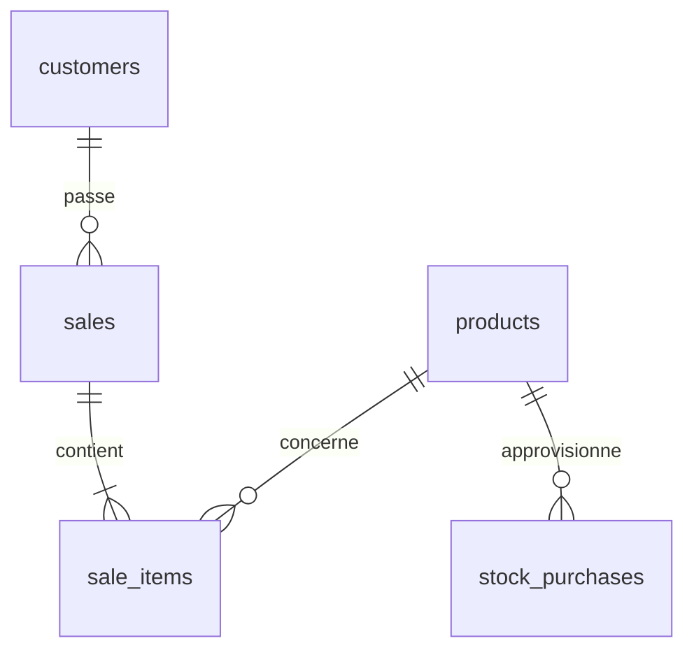

# 🪄 MAGIQUE BOUTIQUE

## 📖 Présentation

MAGIQUE BOUTIQUE est une application en ligne de commande développée en Python permettant de gérer une boutique fictive et son activité commerciale à l'aide d'une base de données SQLite.

Projet réalisé dans le cadre de mon apprentissage de Python et SQL.

## ✨ Fonctionnalités

- gestion des produits
- gestion du stock
- gestion des clients
- gestion des ventes
- suivi du chiffre d'affaires et des marges
- conservation des prix historiques lors des ventes

```text
🧺 PRODUITS
├── Ajouter un produit
├── Afficher les produits
└── Modifier le prix

📦 STOCK
├── Ajouter du stock
├── Modifier le prix fournisseur
└── Afficher les achats de stock

👥 CLIENTS
├── Ajouter un client
├── Afficher les clients
└── Supprimer un client

🛒 VENTES
├── Ajouter une vente
├── Supprimer une vente
└── Afficher les ventes

📊 STATS
├── Chiffre d'affaires
├── Marge
├── Revenu net
├── Classement des produits
└── Classement des clients
```

## 🛠️ Technologies

- Python
- SQLite
- sqlite3
- datetime
- zoneinfo

## 📁 Structure du projet

```text
MAGIQUE BOUTIQUE/
├── main.py
├── menu.py
├── display.py
├── database.db
└── readme.md
```

## 🗄️ Schéma de la base de données


```text
products
├── id
├── name
├── category
├── price
├── stock
└── purchase_price

customers
├── id
├── name
└── city

sales
├── id
├── customer_id
└── date

sale_items
├── id
├── sale_id
├── product_id
├── quantity
├── unit_price
└── unit_purchase_price

stock_purchases
├── id
├── product_id
├── quantity
├── unit_purchase_price
└── date
```
## 🛠️ Conception de la base de données et logique métier

### 🗄️ Modélisation relationnelle

La base SQLite est organisée en cinq tables reliées entre elles par des clés étrangères.
Cette structure permet de distinguer les produits, les clients, les ventes, les lignes de vente et les achats de stock.
Les relations entre les tables sont exploitées à travers des jointures SQL pour récupérer et analyser les données commerciales.

### 📜 Conservation des données historiques

Les prix de vente (`unit_price`) et les prix d'achat (`unit_purchase_price`) sont enregistrés dans la table `sale_items` au moment de chaque vente.

Cette approche permet de conserver les valeurs financières associées à une transaction, indépendamment des modifications ultérieures du catalogue.

Les calculs historiques de chiffre d'affaires et de marge restent ainsi cohérents avec les prix pratiqués lors des ventes.

### 📊 Requêtes SQL et statistiques

L'application utilise des jointures et des fonctions d'agrégation SQL (`JOIN`, `GROUP BY`, `SUM`, `ORDER BY`) pour produire des indicateurs commerciaux :

- Chiffre d'affaires
- Marges commerciales
- Revenu net
- Classement des produits
- Classement des clients

### 🛡️ Validation des opérations

La logique métier comprend des contrôles destinés à éviter certaines opérations invalides, notamment les ventes dont la quantité demandée dépasse le stock disponible et les paniers vides.

## 🚀 Installation


### Prérequis

- Python 3.9 ou supérieur
- SQLite, inclus avec Python

### Installation

Cloner le dépôt :

```bash
git clone <url-du-repo>
```
Puis accéder au dossier du projet :

```bash
cd "2. MAGIQUE BOUTIQUE"
```
Le projet utilise principalement la bibliothèque standard Python.

Sur certains environnements Windows, le paquet `tzdata` peut être nécessaire pour la gestion des fuseaux horaires :

```bash
pip install tzdata
```

## ▶️ Lancement

La base de données SQLite est créée automatiquement lors du premier lancement.

## 🎮 Quelques exemples


### Ajouter un produit

Un produit peut être créé avec son nom, sa catégorie, son prix de vente, son prix d'achat et son stock initial.

### Enregistrer une vente

Une vente est associée à un client et peut contenir plusieurs produits.

Lors de l'enregistrement d'une vente :
- le stock est automatiquement décrémenté ;
- le prix de vente est conservé dans `sale_items` ;
- le prix d'achat est également conservé ;
- une quantité supérieure au stock disponible est refusée ;
- une vente sans produit est automatiquement annulée.

### Consulter les statistiques

L'application permet notamment de calculer :
- le chiffre d'affaires ;
- la marge ;
- le revenu net ;
- le classement des produits par chiffre d'affaires ;
- le classement des clients par chiffre d'affaires.

### Gestion de l'historique

Les prix sont enregistrés au moment de la vente.

Ainsi, une modification ultérieure du prix d'un produit n'altère pas les ventes déjà enregistrées.

## 📚 Compétences mises en pratique

- **Python** : fonctions, modularité et organisation du code
- **Gestion des erreurs** et validation des entrées utilisateur
- **SQL / SQLite** : conception et manipulation d'une base relationnelle
- **Modélisation des données** : tables, clés primaires, clés étrangères et relations 1:N
- **Jointures SQL** : `INNER JOIN`, `LEFT JOIN`
- **Agrégation des données** : `GROUP BY`, `SUM`, `ORDER BY`
- **Gestion des données historiques** : conservation des prix au moment des ventes
- **Développement d'une application CLI** : séparation des responsabilités entre les modules